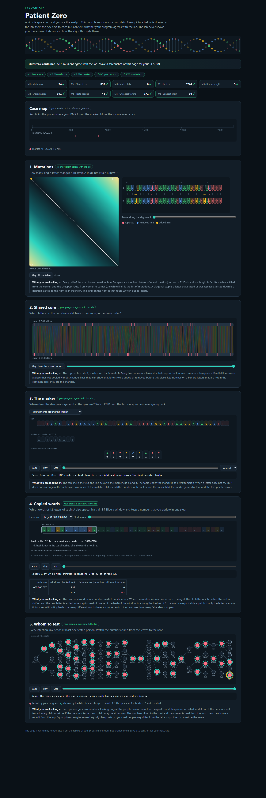

# Assignment 4. Patient Zero

Student ID: 251419
Name: Kuanysh Mussabekuly
Group: SE-2511

This file is the report. Fill it in as you go. How to start: `START_HERE.md`. The task: `docs/Assignment4.pdf`.

## Program output

The 9 lines your program prints on your data (`java -cp out Main`):

    Mutations: 74
    Shared core: 897
    Marker hits: 6
    First hit: 5744
    Border length: 3
    Shared words: 391
    Tests needed: 41
    Cheapest testing: 171
    Longest chain: 30

My outbreak report (a screenshot of `output/outbreak.html`):

## Questions

Mission 1. What does the cell d[i][j] of your table mean, and how is it computed from other cells?

d[i][j] is the smallest number of changes (replace, insert, delete) that turn the first i letters of A into the first j letters of B. The first column is d[i][0] = i (delete everything) and the first row is d[0][j] = j (insert everything). Every other cell looks at the last step: d[i][j] = min(d[i-1][j-1] + (A[i-1] == B[j-1] ? 0 : 1), d[i-1][j] + 1, d[i][j-1] + 1), that is replace/keep, delete, or insert. The answer is the bottom right corner d[n][m].

Mission 2. How is the longest common subsequence different from the longest common substring? My Shared core is bigger than the number of letters that are the same at the same place: why?

A substring must be one block of letters that stand next to each other, while a subsequence only keeps the order and may skip letters in between. Comparing letters "at the same place" breaks as soon as one strain has an insertion or a deletion: everything after it is shifted by one and stops matching. The LCS is allowed to shift (skip a letter in A or in B), so it re-aligns the strains after every insertion or deletion and keeps all those letters, which is why it is much bigger.

Mission 3. What does the prefix function tell you, and why does the pointer in the text never go back in KMP? What is the Border length of my marker and what does it mean?

pi[i] is the length of the longest proper prefix of p[0..i] that is also its suffix. When we have matched k letters and the next one does not fit, the last pi[k-1] letters we already read are exactly the first pi[k-1] letters of the marker, so we can continue from there instead of re-reading the text; the text pointer i only moves forward and the whole search is O(n + m). My marker is ATTGCGATT and its Border length is 3: the word ATT is both the beginning and the end of the marker (ATT-GCG-ATT). It means that after a full match KMP keeps k = 3 instead of 0, so a next occurrence that starts on the last ATT (overlapping the previous one) is still found.

Mission 4. Why must you compare the letters after the hashes are equal? What happens to the cost of Rabin-Karp if many windows have the same hash?

A hash maps 4^12 possible words onto a smaller range modulo MOD, so two different words can get the same number (a collision). If I counted on equal hashes only, a collision would be counted as a shared word and the answer would depend on MOD; comparing the 12 letters removes these false alarms. If many windows have the same hash, almost every lookup ends in a letter-by-letter comparison with many candidates, so the cost goes from about O(n + m) towards O(n * m * k) in the worst case.

Mission 5. What are the two states of a person in your DP, and how do you get the answer for a person from its children? Why does a greedy "test the person with most links first" not always give the cheapest answer?

For every person v (rooted in 0) I keep in[v] = the cheapest cost of the subtree of v when v is tested and out[v] = when v is not tested. If v is tested, each child can choose: in[v] = cost[v] + sum of min(in[c], out[c]); if v is not tested, every link v-c must be covered by the child: out[v] = sum of in[c]. The answer is min(in[0], out[0]), and the chosen people are rebuilt from the root down with the same rule. Greedy looks only at the number of links, not at the costs and not at what the choice forces later. Example: a star with centre cost 100 and three leaves cost 1 each: greedy tests the centre (100), but testing the three leaves covers every link for 3. The DP compares both states of every person, so it never makes such a locally attractive but globally bad choice.

## AI use

I used Claude (Anthropic) as a helper for this assignment: it helped to write and explain the code of the missions (edit distance, LCS, prefix function and KMP, Rabin-Karp, the tree DP) and to draft the answers in this README. I checked the result with `java tools/Check.java` and the lab console, and went through every method by hand on `examples/tiny`. No code was taken from books or websites.

## Timing (Mission 7)

Milliseconds, average of 3 runs, from `java -cp out Bench`.

| test | size | time |
|---|---|---|
| naive search | 20 000 / 40 000 / 80 000 | 27.0 / 68.4 / 139.9 |
| KMP | 20 000 / 40 000 / 80 000 | 1.8 / 0.8 / 0.3 |
| edit distance | 500 / 1000 / 2000 / 4000 | 4.2 / 6.2 / 17.2 / 70.7 |

The naive search grows about 2x when the text doubles, but each step costs up to m = 2000 comparisons (O(n·m)), so it is already about 100 times slower than KMP. KMP stays below 2 ms for all sizes: it is O(n + m) and the numbers are so small that JIT warm-up dominates (the first run is the slowest). Edit distance grows about 4x when the length doubles (17.2 -> 70.7 ms), as expected for an O(n·m) table; the smallest sizes are too fast to show it clearly.

## Complexity

n is the length of the text (or of a strain), m the length of the pattern, k the length of the window, v the number of people.

| algorithm | time | space | assumptions |
|---|---|---|---|
| Edit distance | O(n·m) | O(n·m) | full (n+1)×(m+1) table, every cell O(1) from three neighbours; can be cut to O(m) with two rows |
| LCS | O(n·m) | O(n·m) | same table shape, every cell O(1) |
| Prefix function and KMP | O(n + m) | O(m) | k grows by at most 1 per letter and every fall-back decreases it, so the while-loops are amortised; the hit list is O(number of hits) |
| Rabin-Karp (shared words) | O(n + m) expected, O(n·m·k) worst case | O(m) | rolling hash is O(1) per window; HashMap lookup O(1) on average; letters are compared only on equal hashes, few collisions with MOD = 1e9+7 |
| Tree DP | O(v) | O(v) | every link is looked at twice (once from each side), BFS order instead of recursion; same for the longest chain |
